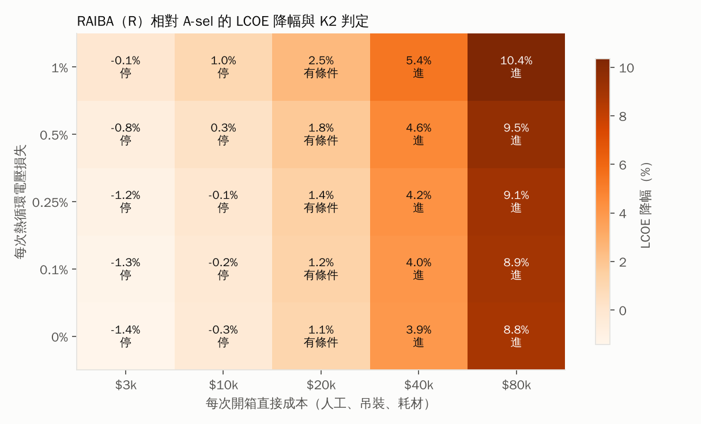

# 開箱代價的量化

> 記錄日期：2026-11-24
> 程式：[`models/sofc_lcoe/service_cost.py`](../../models/sofc_lcoe/service_cost.py)、[`service_scenarios.py`](../../models/sofc_lcoe/service_scenarios.py)
> 原始輸出：[`models/results/SERVICE_COST.md`](../../models/results/SERVICE_COST.md)
> 文獻：[`../sources/THERMAL_CYCLING_SERVICE_2026-11-24.zh-TW.md`](../sources/THERMAL_CYCLING_SERVICE_2026-11-24.zh-TW.md)

> **2026-11-26 更正：** 本文的 K2 判定（例如直接成本 ≥ 約 $33k 為「進」）是以「每個電堆一台 DC/DC」的粒度算的。實際只能做到 4–5 堆一群，以群級粒度計，K2 在既有假設下為「停」（−0.52%），只有固定串聯的非計畫開箱有明顯額外代價時才回到有條件；開箱直接成本很高時，贏的是小模組整個抽換。見 [`LCOE_DEGRADATION_MODEL.zh-TW.md`](LCOE_DEGRADATION_MODEL.zh-TW.md) 第 4.1 節與 [RAIBA repo `docs/sofc-gw/03_raiba_proscons/`](https://github.com/pcpcchen-coder/RAIBA/blob/main/docs/sofc-gw/03_raiba_proscons/RAIBA_PROS_CONS.zh-TW.md)。

## 0. 結論

1. **熱循環傷害比原本假設的小。**
   - 文獻中央值每次約 0.1% 電壓損失。
   - 換算成金錢：一次開箱讓 17 個沒換的電堆各經歷一次熱循環，只值約 **$700**；不成熟設計（0.8%＋1% 洩漏機率）約 $5,400。
2. **真正決定 RAIBA 價值的是「每次開箱的直接成本」。**
   - 直接成本是人工、吊裝、耗材，而**這個數字完全沒有公開數據**。
   - 直接成本 ≥ 約 $33k 時，RAIBA 相對 A-sel 的 LCOE 降幅 ≥ 3%（K2「進」）。
   - 直接成本 ≤ $10k 時，RAIBA 不划算（K2「停」）。
3. **用文獻中央值重算，RAIBA 只省 1.3%**，落在「有條件」區。不成熟設計的情境是 6.6%，成熟設計的情境是 −1.1%。
4. **最壞情況是 redox。** 冷卻時失去陽極保護氣，陽極支撐電池可能整堆報廢。如果這種事件有非零機率，開箱代價會大幅上升。【假說】
5. **Bloom 的整模組在線抽換完全避開了這個問題。** 被換下的模組送回工廠翻修，其他模組不受影響。這是 RAIBA 必須比較的對手方案。【外部】

## 1. 代價拆解

每次開箱總代價 = **直接成本** ＋ **熱循環傷害** ＋ **停機損失**

| 項目 | 怎麼算 | Evidence |
|---|---|---|
| 直接成本 | 人工、吊裝、耗材、試運轉 | 【未知】→ 情境值 $5k／$20k／$50k |
| 熱循環傷害 | 未更換電堆數 ×（裕度消耗比例＋洩漏機率）× 換堆成本（$4,752／堆） | 電壓損失【外部區間】；洩漏機率【假說】 |
| 停機損失 | 模組功率 × 停機天數 × 電價（$60/MWh），屬上限 | 停機天數【假說】 |

**電壓損失換算成裕度消耗：** 在最佳操作點（j₀ = 0.31、δ = 25%），每 1% 電壓損失約消耗 7.1% 的 EOL 裕度。

> 更正：模型原本的熱循環懲罰 0.02 對應約 0.28% 電壓損失，不是原註解寫的 0.5%，已在 `params.py` 修正。

## 2. 文獻情境

| 情境 | 電壓損失／次 | 洩漏機率／次 | 直接成本 | 停機 | 熱循環傷害 | 停機損失上限 | RAIBA（R）相對 A-sel |
|---|---|---|---|---|---|---|---|
| 低（成熟設計） | 0.01% | 0.01% | $5,000 | 1 天 | $65 | $415 | **−1.1%** |
| 中（文獻中央值） | 0.1% | 0.2% | $20,000 | 3 天 | $732 | $1,245 | **1.3%** |
| 高（不成熟設計） | 0.8% | 1% | $50,000 | 5 天 | $5,371 | $2,075 | **6.6%** |

## 3. 二維掃描

| 電壓損失／次 ＼ 直接成本 | $3k | $10k | $20k | $40k | $80k |
|---|---|---|---|---|---|
| 0% | −1.4 | −0.3 | 1.1 | 3.9 | 8.8 |
| 0.1% | −1.3 | −0.2 | 1.2 | 4.0 | 8.9 |
| 0.25% | −1.2 | −0.1 | 1.4 | 4.2 | 9.1 |
| 0.5% | −0.8 | 0.3 | 1.8 | 4.6 | 9.5 |
| 1% | −0.1 | 1.0 | 2.5 | 5.4 | 10.4 |

**解讀【假說】：**
- 橫向（直接成本）的影響遠大於縱向（熱循環損失）。
- 熱循環損失要到每次 1% 以上，才會明顯改變判定。

## 4. 還不知道、而且決定結論的事

| 未知 | 為什麼重要 | 可以怎麼量 |
|---|---|---|
| 每次開箱的直接成本 | 決定 K2 進或停（分界約 $33k） | 熱箱維修工序的工時拆解（bottom-up） |
| 20 堆熱箱的降溫／升溫時間 | 決定停機損失與工時 | 熱箱熱傳模型＋測試數據 |
| 每次循環的洩漏／失效機率 | 文獻完全沒有統計 | 多堆重複循環，配合韋伯分析 |
| 每次熱循環電壓損失（針對我們要用的電堆） | 文獻跨 80 倍 | 短堆加速循環試驗 |
| HOT-IDLE（熱態 OCV 待機）期間的劣化 | RAIBA 隔離電堆時，會讓它在熱態待機幾週 | 熱態 OCV／低電流長時間保持試驗 |
| 失去保護氣時的損傷門檻 | 最壞情況：整堆報廢 | 控制 redox 事件的時間與溫度 |

這些都適合交給學界合作執行，委託內容見 `reports/SOFC_開箱代價_研究委託_單頁.pptx`（項目 W1–W6）。

## 5. 模型限制

- 模型時間步長是 1 個月，停機最短以 1 個月計，對 A-sel 偏保守（A-sel 開箱次數較多）。
- 洩漏機率以「期望裕度消耗」近似（洩漏 = 整個裕度歸零 × 機率），沒有模擬洩漏造成的連帶損害。
- 沒有模擬 redox 整堆報廢事件。
- HOT-IDLE 期間的劣化沒有計入。這對 RAIBA 不利，納入後 RAIBA 的優勢會略降。
