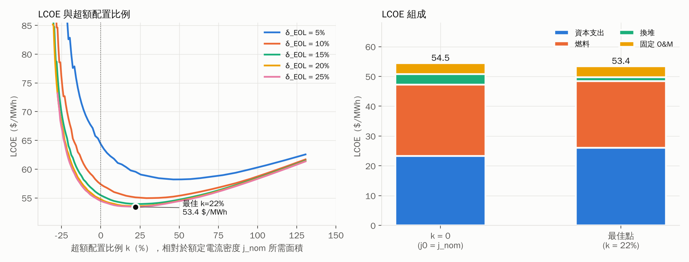
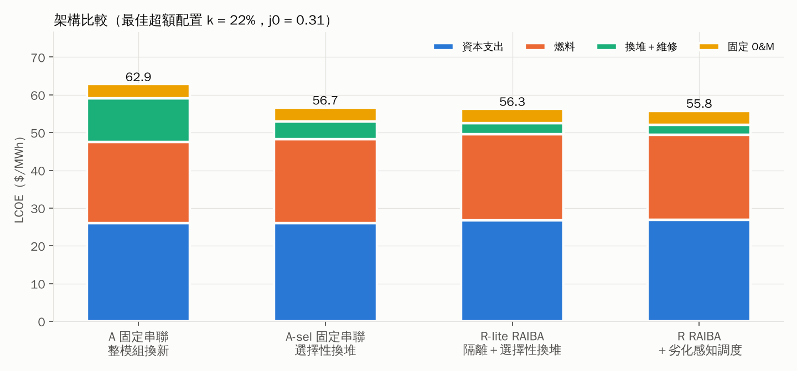
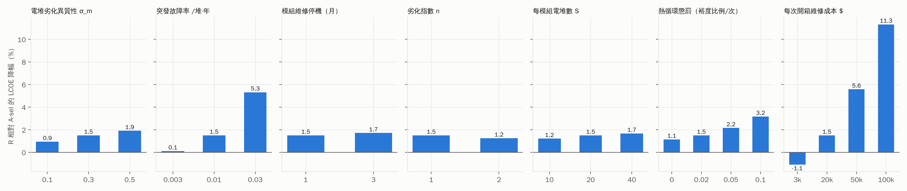
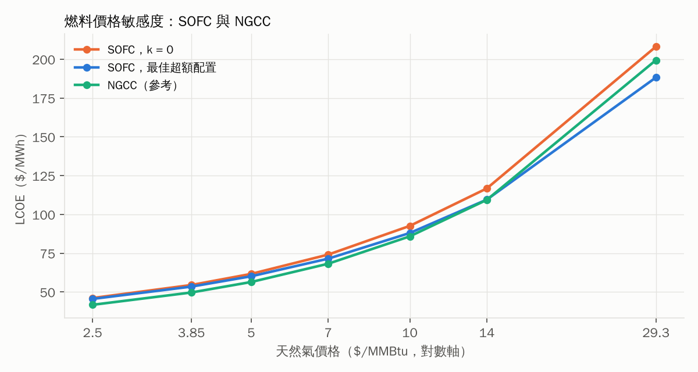

# LCOE ＋ 劣化模型：超額配置與類 RAIBA 架構的價值

> 記錄日期：2026-11-23
> 程式：[`models/sofc_lcoe/`](../../models/sofc_lcoe/)，重現方式見 [`models/README.md`](../../models/README.md)
> 原始輸出：[`models/results/RESULTS.md`](../../models/results/RESULTS.md)、`results.json`
>
> **Evidence layer：** 整份模型是【假說】層級的工程推估。參數盡量錨定在【外部】數據上（見第 2 節），但模型結構、成本拆分、異質性與故障參數都是假說。**這裡的數字是決策輔助，不是預測。**

---

## 0. 結論摘要

| # | 問題 | 答案（基準參數） | 信心 |
|---|---|---|---|
| 1 | 超額配置有沒有用？ | **最佳 k≈22%，LCOE 只降 1.9%。** 但劣化率是 Jülich 實測平均 0.5%/kh 時，LCOE 降 7.3%；1%/kh 時降 16%。資本支出若達到 DOE 目標，也會降 7% | 中：方向穩健，幅度取決於現場劣化率 |
| 2 | RAIBA 電堆級可重組有沒有用？ | **主要的錢不是 RAIBA 省下來的，而是「選擇性換堆」這個維運策略省下來的**（A → A-sel 省 10%）。RAIBA 相對 A-sel 再省 **1.5%**（已扣 RAIBA 成本）。損益兩平增量成本約 **$107–157/kW** | 低到中：取決於兩個【未知】參數 |
| 3 | RAIBA 的價值由什麼決定？ | **每次開熱箱的代價**（維修成本＋熱循環對其他電堆的傷害）。開箱成本從 $3k 到 $100k，RAIBA 的優勢從 −1.1% 變成 +11.3% | 高（模型內）：這是很清楚的單調關係 |
| 4 | GW 級 SOFC 電廠能不能跟 NGCC 競爭？ | 以美國氣價計，SOFC 資本支出要 **≤ $1,720/kW** 才能打平，**≤ $2,450/kW** 才能在 1.2 倍以內。目前由 Bloom 案例推算約 $5,000–5,700/kW → **今天不具競爭力** | 中：NGCC 與 SOFC 成本都有很大的區間 |

**一句話：** 超額配置和 RAIBA 都是「改善 10% 左右」的槓桿；決定 GW 級 SOFC 生死的是**資本支出要降一半以上**。RAIBA 能不能進場，取決於「開一次熱箱有多貴」，而這個數字可以量測。

---

## 1. 模型結構

### 1.1 第一層：均質、確定性（超額配置最佳化）

**決策變數：**
- **j₀：** BOL 操作電流密度。它等價於超額配置比例 k = A/A_nom − 1，其中 A_nom 是以額定 j_nom = 0.4 A/cm² 運轉所需的面積。
- **δ_EOL：** 換堆判準，也就是電壓（等於效率）比 BOL 下降多少就換堆。

**物理：**
- 電壓：V = E₀ − ASR·j（線性極化近似）。
- 劣化：dASR/dt = a·m·(j/j_ref)ⁿ，其中 a 由「在 j_ref、定電流下電壓劣化 d_ref %/kh」換算。
- 運轉方式：每片電池維持定功率；ASR 上升時，電流自動增加。
- 燃料：每 1 A 電流需要 1.039 W/U_f 的 CH₄（LHV），由 CH₄ 的 8 電子反應推得。

**經濟：**
- 25 年月步長折現現金流，折現率 8%。
- 資本支出拆兩部分：跟淨容量成正比的部分，以及跟電池面積成正比的部分。超額配置只放大後者。
- 電廠結束時，依電堆剩餘裕度計入殘值。

**主要取捨：**

| j₀ 低（超額配置多） | j₀ 高（超額配置少） |
|---|---|
| 資本支出 ↑ | 資本支出 ↓ |
| 電壓高 → 燃料 ↓ | 電壓低 → 燃料 ↑ |
| 劣化慢 → 換堆 ↓ | 劣化快 → 換堆 ↑ |

### 1.2 第二層：異質機隊 Monte Carlo（架構比較）

**模擬設定：**
- 每次模擬 50 個模組 × 20 個電堆。
- 每個電堆的劣化倍率 m ~ lognormal(σ=0.3)，BOL ASR 的變異係數 5%。
- 突發故障率 1%/堆·年。
- 跑 3 個隨機種子，報告平均 ± 標準差。

| 架構 | 拓樸 | 調度 | 觸發維修 | 維修時換什麼 |
|---|---|---|---|---|
| **A** 固定串聯 | 模組內串聯，模組級 DC/DC | 模組間平均分配 | 任一電堆故障或到 EOL | **整個模組** |
| **A-sel** 固定串聯＋選擇性換堆 | 同 A | 同 A | 同 A | 故障／EOL／剩餘裕度 < 30% 的電堆 |
| **R-lite** RAIBA 隔離版 | 電堆級 DC/DC，可單獨隔離 | 電堆間平均分配 | 一個模組隔離 ≥ 3 個電堆 | 已隔離＋剩餘裕度 < 30% |
| **R** RAIBA 完整版 | 同 R-lite | **劣化感知經濟調度** | 同 R-lite | 同 R-lite |

**所有架構共同的條件：**
- 熱箱內換堆需要降溫，所以**維修時整個模組停機 1 個月**。模型不假設能熱抽換。
- 每次開箱，**未更換的電堆都承受一次熱循環懲罰**。
- 電力電子額定為設計功率 × 1.1，限制每個單元的最大出力。
- RAIBA 的增量成本：$50/kW 資本支出，加上 0.5 個效率點的額外損失。

**R 的經濟調度：** 每個時步求解
min Σ [ c_ASR·dASR_i/dt + c_fuel·j_i ]，限制條件 Σ p_i = P_target。
- c_ASR = 換堆成本 ÷ ASR 裕度，也就是每消耗 1 單位 ASR 裕度的成本。
- 劣化快或 ASR 高的電堆會自動分到較少功率。
- 這是 RAIBA「Predict + Decide + Act」裡 Decide 那一層的最小實作。

### 1.3 驗證

| 檢查 | 結果 |
|---|---|
| 第二層退化成均質、無故障時，是否等於第一層 | 49.7 對 49.5 $/MWh（差距來自時間步長）✔ |
| 額定點、δ=15% 時的電堆壽命 vs Bloom 2018 年後批次 ≥5 年【外部】 | 模型 5.2 年 ✔ |
| 額定點、δ=25% 時的電堆壽命 vs NETL 2022 的 7.3 年【外部】 | 模型 7.0 年 ✔ |
| k=0 的 LCOE vs NETL 不含 CCS 案例 $40–47/MWh【外部】 | 模型 54.5（NETL 用 2018 美元、資本支出假設較低）△ |

---

## 2. 參數與來源

| 參數 | 值 | Evidence |
|---|---|---|
| 額定點 | 0.8 V @ 0.4 A/cm² → ASR₀ = 0.5 Ω·cm²（E₀ = 1.0 V） | 【外部】NETL 2022；E₀ 為【假說】 |
| 劣化率 d_ref | 0.2%/kh（敏感度 0.1–1.0） | 【外部】NETL 2022、Ceres；Jülich 平均 0.5；DOE 系統現況 1–1.5 |
| 劣化指數 n | 1（敏感度 0–2） | 【假說】文獻結論互相矛盾 |
| 電池／堆疊 | 550 cm²，100 片／堆 | 【外部】NETL 2022 |
| 每模組電堆數 | 20 | 【假說】 |
| 電堆成本 | $225/kW | 【外部】NETL 2022／DOE |
| 資本支出合計（k=0） | $2,000/kW（情境：$900／$2,000／$5,000） | 【假說】DOE 目標 $900【外部】；Bloom 案例推算約 $5,700【假說】 |
| 天然氣 | $3.85/MMBtu | 【外部】EIA STEO 2026-11 |
| 折現率／壽期 | 8%／25 年 | 【假說】（EIA WACC 7.27%） |
| 燃料利用率／電力電子效率／寄生耗電 | 0.85／0.97／5% | 【假說】 |
| 劣化異質性 σ_m | 0.3 | 【假說】Lin 2025 證實堆內差異存在，但沒有提供分布 |
| 突發故障率 | 1%/堆·年 | 【未知】 |
| 每次開箱成本 | $20,000 | 【未知】 |
| 熱循環懲罰 | 每次消耗 2% 的 EOL 裕度（約等於電壓損失 0.5%） | 【未知】 |
| RAIBA 增量 | $50/kW、0.5 個效率點 | 【假說】 |
| NGCC | $1,800/kW、58% LHV、容量因數 0.85 | 【外部】Lazard 2026（資本、熱耗率）；其餘為【假說】 |

---

## 3. 結果

### 3.1 超額配置（第一層）

| 項目 | k = 0（j₀ = 0.40） | 最佳（j₀ = 0.31，k = 22%） |
|---|---|---|
| BOL 電壓 | 0.800 V | 0.845 V |
| 電堆壽命 | 7.0 年 | 13.8 年 |
| 平均淨效率（LHV） | 54.6% | 57.7% |
| 資本支出 | $2,085/kW | $2,326/kW |
| LCOE | 54.5 | **53.4 $/MWh（−1.9%）** |

**敏感度（最佳 k 與 LCOE 降幅）：**

| 參數 | 值 → 最佳 k／LCOE 降幅 |
|---|---|
| 劣化率 d_ref | 0.1 → 11%／0.5%；**0.2 → 22%／1.9%**；0.5 → 46%／7.3%；1.0 → 70%／16.3% |
| 劣化指數 n | 0 → 8%／0.4%；1 → 22%／1.9%；2 → 25%／3.9% |
| 模組 BoP 成本 | $300 → 57%／6.1%；$1,200 → 8%／0.5% |
| 天然氣 | $3.85 → 22%／1.9%；$12 → 52%／5.5%；$29.3 → 117%／9.6% |
| 資本支出情境 × 劣化率 | DOE $900＋1%/kh → k=117%／**27.8%**；現況 $5,000＋1%/kh → k=78%／27.3% |

**解讀：**
1. 【假說】超額配置的價值**幾乎完全取決於現場劣化率**。
   - 0.2%/kh 是實驗室最佳或目標值，在這個劣化率下超額配置幾乎沒用。
   - 0.5%/kh 是 Jülich 長期實測的平均，在這個劣化率下 LCOE 降 7%。
   - 1%/kh 是 DOE 估計的系統現況，在這個劣化率下 LCOE 降 16–28%。
2. 【假說】**最佳 δ 幾乎都落在上限 25%。** 也就是說，模型傾向「晚一點換堆」。實務上 δ 會受發熱與冷卻空氣量限制，這個上限需要工程驗證。
3. 【未知】**熱自持下限 j_min** 在 0.25 以下不會綁住最佳解；到 0.35 時才會限制超額配置。實際的下限需要熱平衡模型或實測。

### 3.2 架構比較（第二層）

最佳超額配置（k = 22%）下：

| 架構 | LCOE $/MWh | 換堆＋維修 | 淨效率 | 換堆數 /GW·yr | 每堆交付 MWh | 開箱次數 /模組·yr |
|---|---|---|---|---|---|---|
| A 整模組換新 | 62.9 | 11.7 | 60.9% | 17,400 | 429 | 0.23 |
| A-sel 選擇性換堆 | 56.7 | 4.7 | 58.5% | 5,390 | 1,041 | 0.31 |
| R-lite | 56.3 | 3.0 | 57.0% | 4,880 | 1,111 | 0.16 |
| **R** | **55.8** | 2.6 | 57.4% | 4,760 | 1,128 | 0.13 |

- **R 相對 A-sel：** LCOE −1.5%（已扣 RAIBA 成本）；每堆交付能量 +8.3%；開箱次數 −57%。
- **損益兩平：** RAIBA 不計成本時可省 1.8 $/MWh（3.2%）→ 可容許的增量資本支出為 **$121/kW（增量損失 0）**，或 **$107/kW（增量損失 0.5 個效率點）**。k=0 時這兩個數字是 $157／$139/kW。
- **可用率：** 各架構都在 99.8–100%，差異不明顯。這是因為電力電子保留了 10% 餘裕，加上超額配置提供的備用容量。

**RAIBA 優勢的敏感度（R 相對 A-sel 的 LCOE 降幅）：**

| 參數 | 值 → R 降幅 |
|---|---|
| **每次開箱成本** | $3k → **−1.1%**；$20k → 1.5%；$50k → 5.6%；$100k → **11.3%** |
| **熱循環懲罰** | 0 → 1.1%；2% → 1.5%；5% → 2.2%；10% → 3.2%（每堆交付能量 +22%） |
| **突發故障率** | 0.3% → 0.1%；1% → 1.5%；3% → **5.3%** |
| 劣化異質性 σ_m | 0.1 → 0.9%；0.5 → 1.9% |
| 每模組電堆數 | 10 → 1.2%；40 → 1.7% |
| 劣化指數 n | 1 → 1.5%；2 → 1.2% |

**解讀：**
1. 【假說】**最大的一筆錢是「不要整模組換新」**（A → A-sel，約省 10%）。這是**維運策略**，用固定串聯的硬體就能做到，不需要 RAIBA。
2. 【假說】RAIBA 的增量價值來自**少開熱箱**：它可以先把壞的電堆隔離、繼續運轉，等累積幾個再一起修。
   - 所以它的價值跟**開箱代價**（人工、吊裝、停機、熱循環傷害）和**故障率**成正比。
   - 跟「劣化感知調度」的關係反而不大：R 相對 R-lite 只再省 0.5–1%。
3. 【RAIBA 事實＋假說】這跟 RAIBA 電池版的結論不同。電池版的價值主要來自「弱者綁架」與 SOC 平衡。SOFC 版的價值主要來自「**避免熱箱開箱**」，因為高溫系統每開一次的代價很高。
4. 【外部】**Bloom 已經在 PM 級做到在線抽換**（"Independent power modules can be replaced while the system remains online"）。也就是說，業界現行做法本來就是「模組級 R-lite」。RAIBA 對 SOFC 的機會在**更細的粒度（電堆或電堆群）**，前提是熱箱內電氣隔離的成本夠低。

### 3.3 跟 NGCC 比較

| 天然氣 $/MMBtu | SOFC 最佳 | NGCC | 比值 |
|---|---|---|---|
| 3.85（美國） | 53.4 | 49.6 | 1.08 |
| 12（亞洲 LNG 量級） | 約 98* | 97.6 | 約 1.0 |
| 29.3（Wei 2026 的假設） | 188.2 | 199.4 | 0.94 |

\* 介於 10 與 14 的掃描點之間。

**跟 NGCC 打平所需的資本支出（k=0 口徑）：**

| 天然氣 | SOFC/NGCC = 1.0 | SOFC/NGCC = 1.2 |
|---|---|---|
| $3.85 | ≤ **$1,720/kW** | ≤ $2,450/kW |
| $12 | ≤ $1,920/kW | ≤ $3,240/kW |

【假說】氣價越高，SOFC 的效率優勢越值錢；但即使在亞洲氣價下，資本支出也要降到現況推算值（約 $5,000/kW）的一半左右。**對 GW 級電廠來說，「資本支出」這個門檻比預測性維護和 RAIBA 都重要一個量級。**

尚未納入模型、但可能改變結論的因素：
- **碳價：** SOFC 的陽極尾氣 CO₂ 濃度高，碳捕集可能比 NGCC 便宜（NETL 有含 CCS 的案例）。【外部＋假說】
- **電網價值：** 模組化、建設期短、可分散設置。【假說】
- **用水：** Wei 2026 的 hybrid 設計可減少用水 59.9%。【外部】

---

## 4. Kill criteria（決策門檻）

> 門檻值是本專案提出的【假說】，用來把「繼續、有條件繼續、停止」講清楚。

| # | 判準 | 門檻 | 基準結果 | 判定 |
|---|---|---|---|---|
| K1 | 超額配置的 LCOE 降幅 | < 2% 停；2–5% 有條件；≥ 5% 進 | 1.9%（0.2%/kh）；7.3%（0.5%/kh） | **有條件**：先確認現場劣化率 |
| K2 | RAIBA（R）相對 A-sel 的淨 LCOE 降幅 | < 1% 停；1–3% 有條件；≥ 3% 進 | 1.5% | **有條件** |
| K3 | 損益兩平增量成本 vs 實際電堆級 DC/DC 增量成本 | 實際成本 > 損益兩平 → 停 | 損益兩平 $107–157/kW；實際成本【未知】 | **待量測** |
| K4 | 每堆交付能量增幅（RAIBA 北極星指標） | < 5% 弱；> 10% 值得；> 20% 有吸引力 | 8.3%（熱循環懲罰 10% 時為 22%） | **中間** |
| K5 | GW 級電廠 SOFC/NGCC 的 LCOE 比 | > 1.2 → GW 級商用電廠不成立，應轉向資料中心等分散式應用 | 資本支出 $2,000 時 1.08；$5,000 時約 2.0 | **以現況成本計：不成立** |

**要從「有條件」變成「進」或「停」，最需要量測的是：**

1. **每次熱箱開箱的總代價**：人工、吊裝、停機，加上熱循環造成的 ASR 增加。→ 決定 K2、K4。
2. **現場長期劣化率**，以及它對電流密度的依賴（n）。→ 決定 K1。
3. **電堆突發故障率。** → 決定 K2。
4. **電堆級 DC/DC 的增量成本與損失。** → 決定 K3。
5. **大規模量產下的系統資本支出。** → 決定 K5。

---

## 5. 模型限制

- 線性極化近似，沒有分開活化、濃度、歐姆極化；E₀ 是假設值。
- 劣化只用 ASR 增長表示，沒有區分機理（Ni 粗化、Cr 毒化等），也沒有可逆劣化。
- 電堆之間沒有熱耦合，也沒有燃料分配耦合。實際上，Lin 2025 指出的堆內差異會讓弱者問題更嚴重。
- 沒有燃料側隔離（閥件）的成本與失效。
- 沒有部分負載、啟停、升降載速率，模型只考慮基載。
- 第二層只模擬 1,000 個電堆並等比例放大，GW 級的物流（例如每年換數千個電堆）沒有建模。
- NGCC 用簡化的 LCOE 公式，沒有碳價。
